<div align="center">

# Fraud Detection with Graph Databases and Graph Neural Networks

### ...with LLM explanations that are checked, sentence by sentence


**Group 18 · Project 10**
Darshitha Gongle · Maninderjit Singh Bhullar · Mithun Menon · Nandan Reddy Jalli · Reshikesh Reddy Puttamreddy

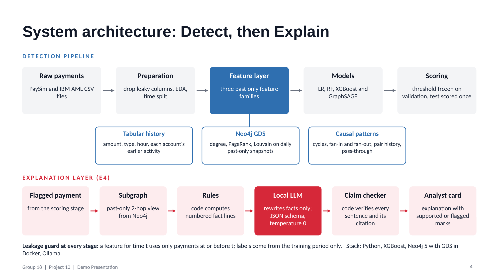

</div>

---

## The project in 60 seconds

Fraud and money laundering are not single bad payments. They are **shapes in a network**: money that returns to where it started, one account that pays many, many accounts that pay one.

We ask two questions and answer them with one strict, time-ordered protocol:

1. **How much does the graph really add** once every source of leakage is removed?
2. **Can an LLM explain an alert** without inventing facts?

| | |
|---|---|
| **5.08M** payments in the IBM AML graph | **0.594** best PR-AUC (random guess is 0.001) |
| **0.23 → 0.59** PR-AUC from plain tabular to graph + causal features | **0.66 → 0.99** PaySim score when leaky balance columns are allowed |
| **1,676** LLM sentences checked by code | **2** wrong claims, both caught by the checker |

## Contents

[Why graphs](#why-graphs) · [Architecture](#architecture) · [Datasets](#datasets) · [Experiments](#experiments) · [Results](#results) · [Checked explanations](#checked-explanations-e4) · [See the real graph](#see-the-real-graph) · [Findings](#what-we-found) · [Leakage rules](#leakage-rules) · [Repository map](#repository-map) · [Run it yourself](#run-it-yourself) · [Team](#team) · [References](#references)

---

## Why graphs

A model that looks at one payment at a time cannot see a ring. These are the laundering shapes we look for, drawn around real flagged payments from the IBM AML test days (accounts are anonymised):

<p align="center">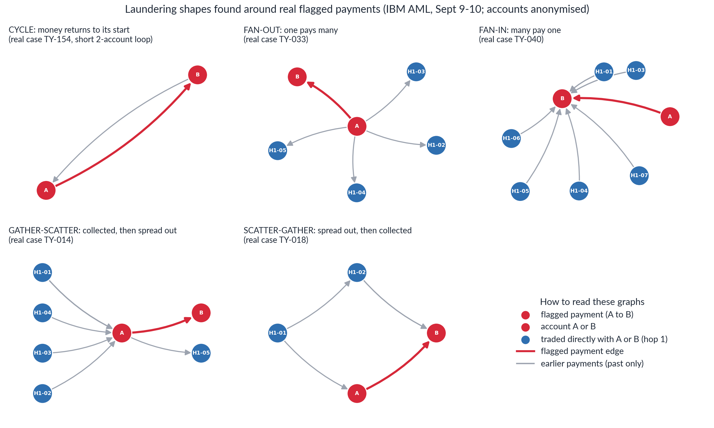</p>

<details>
<summary><b>Click to see full real laundering attempts from IBM's ground-truth pattern file</b></summary>
<p align="center">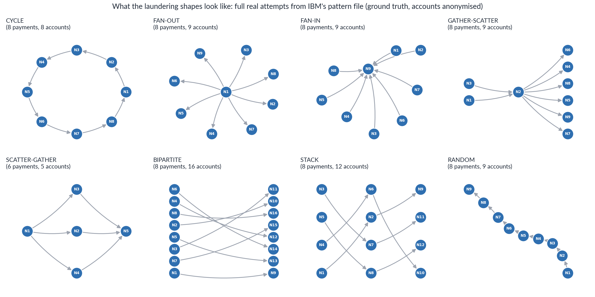</p>
</details>

## Architecture

The system has two halves. The **detection pipeline** turns raw payments into past-only features, trains four model families and scores them once. The **explanation layer (E4)** takes a flagged payment, builds its past-only neighbourhood in Neo4j, lets plain rules compute numbered fact lines, lets a small local LLM only *rewrite* those facts, and then checks every sentence with code.

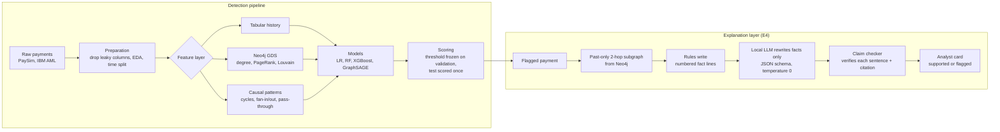

**Leakage guard at every stage:** a feature for time *t* uses only payments at or before *t*, and labels come only from the training period.

## Datasets

| | PaySim | IBM AML (HI-Small) |
|---|---|---|
| What it is | Mobile-money simulator | Money-laundering simulator |
| Size | 6.36M rows, 2.77M TRANSFER and CASH_OUT rows used | 5,078,345 payments, 515,088 accounts, 18 days |
| Positive rate | 0.30% fraud in the rows used | 0.102% laundering (5,177 payments) |
| Graph | Thin and star-shaped, only 0.06% of senders send again | Dense, 78% of accounts both send and receive |
| Split (never shuffled) | train steps 1-446, validation 447-595, test 596-743 | train Sept 1-6, validation Sept 7-8, test Sept 9-18 |

IBM headline numbers use the normal test days, **Sept 9-10** (956 laundering payments out of 862,792, a rate of 0.111%). Sept 11-18 is a simulator tail with a very high laundering share and is reported separately. Download steps are in [`data/README.md`](data/README.md).

## Experiments

| | Experiment | What changes |
|---|---|---|
| **E1** | Tabular baselines | Logistic regression, random forest and XGBoost on amount, type, time and each account's earlier activity |
| **E2** | Graph features | Neo4j GDS (degree, PageRank, Louvain) on daily past-only snapshots, plus causal pattern features (cycles, fan-in and fan-out, pair history, pass-through) |
| **E3** | GraphSAGE | Two-layer GraphSAGE with time-aware neighbour sampling, plus a twin with the graph removed |
| **E4** | Explanations | Rules compute numbered fact lines, a local LLM only rewrites them, a claim checker verifies each sentence and its citation |

## Results

### IBM AML: every feature step adds signal

<p align="center">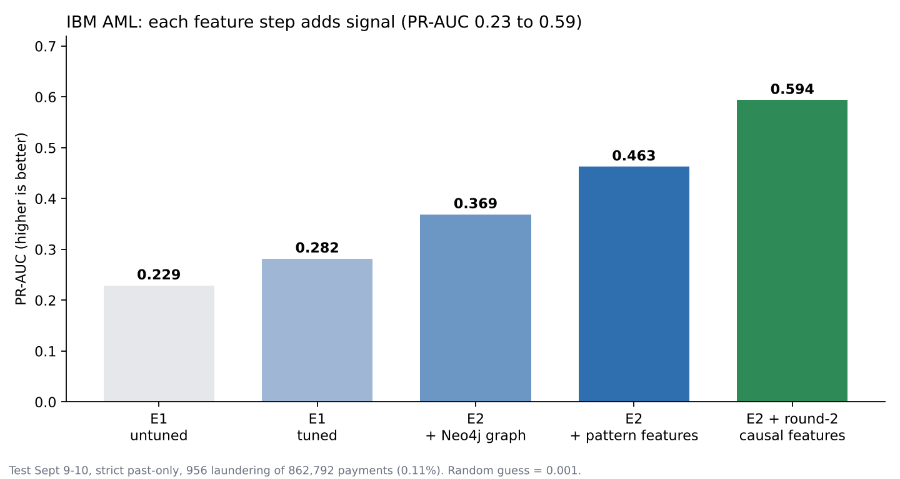</p>

Normal test days (Sept 9-10), laundering rate 0.111%. Precision and recall are at the threshold frozen on validation.

| Experiment | Model | PR-AUC | Precision | Recall |
|---|---|---|---|---|
| E1 | XGBoost, untuned | 0.229 | 0.318 | 0.265 |
| E1 | XGBoost, tuned | 0.282 | 0.279 | 0.401 |
| E2 | + Neo4j graph features | 0.369 | 0.315 | 0.441 |
| E2 | + pattern features | 0.463 | 0.318 | 0.517 |
| E2 | + causal features (best) | **0.594** | 0.384 | 0.602 |
| E3 | GraphSAGE v2 | 0.428 | 0.474 | 0.410 |
| E3 | Same network, graph removed | 0.408 | 0.503 | 0.384 |

<p align="center">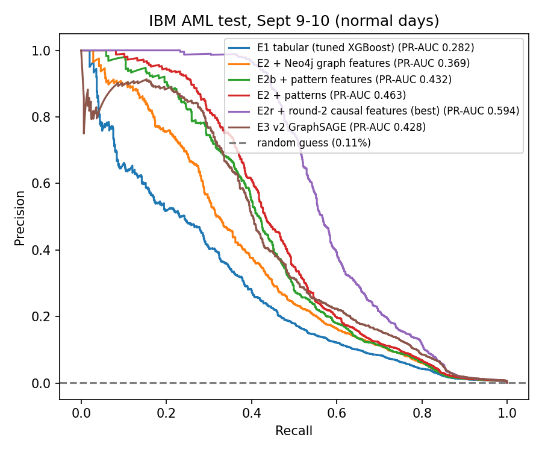</p>

The purple curve (best run) is highest at most recall levels. Tuning adds +0.05, Neo4j structure +0.09, pattern features +0.09 and round-2 causal features +0.13 (95% bootstrap interval 0.11 to 0.15).

### The graph helps only when the network is rich

<p align="center">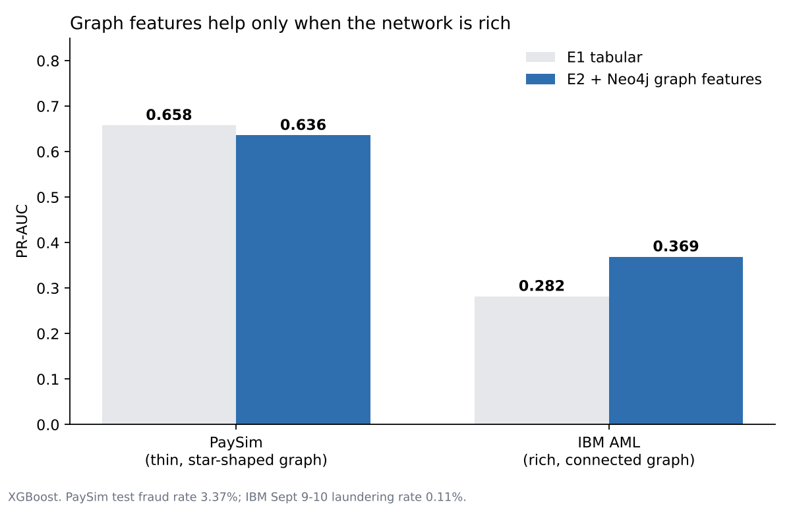</p>

On the dense IBM graph the graph features lift PR-AUC (bootstrap +0.08 to +0.09). On the sparse, star-shaped PaySim graph they do not help.

### Leakage can fake a great score

<p align="center">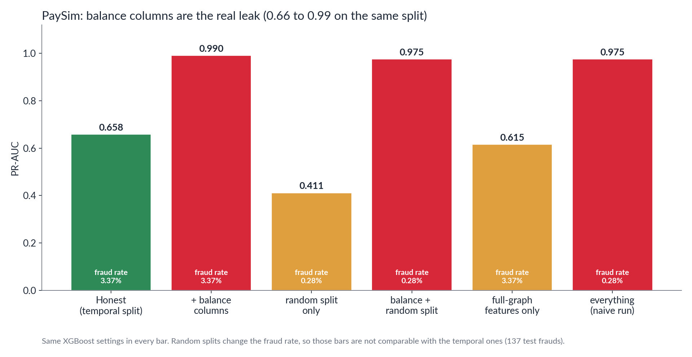</p>

The same XGBoost goes from **0.658 to 0.990** when the four balance columns are allowed, a score that would never hold in real use. Random splits also change the fraud rate, so those bars cannot be compared with the temporal ones.

| PaySim run | PR-AUC |
|---|---|
| Honest E1 (past-only tabular) | 0.658 |
| Honest E2 (past-only graph snapshots) | 0.636 |
| Naive: add the four balance columns | 0.990 |
| Naive: random split only | 0.411 (fraud rate 0.28% in that split) |
| Naive: graph features from the full graph | 0.615 |

### Learned message passing vs explicit features

<p align="center">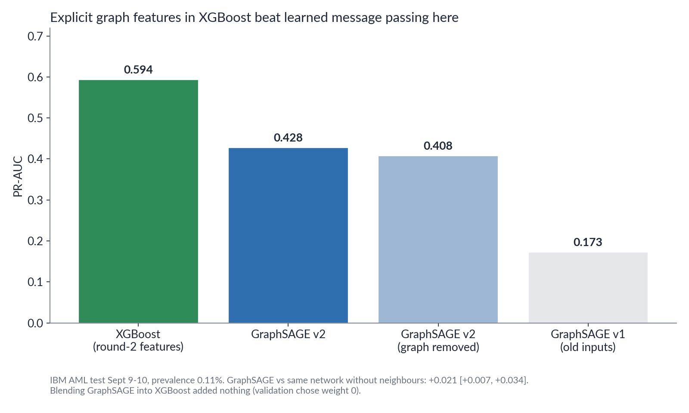</p>

Explicit graph features in XGBoost (0.594) beat GraphSAGE (0.428). Neighbours still add a small +0.02 inside GraphSAGE, and blending GraphSAGE into XGBoost added nothing.

## Checked explanations (E4)

An alert is only useful if an analyst can trust the explanation. Every sentence below cites a rule-made fact line (such as `[F6]`) and gets a check mark only if code can verify it.

<table>
<tr>
<td align="center"><b>All sentences supported</b><br>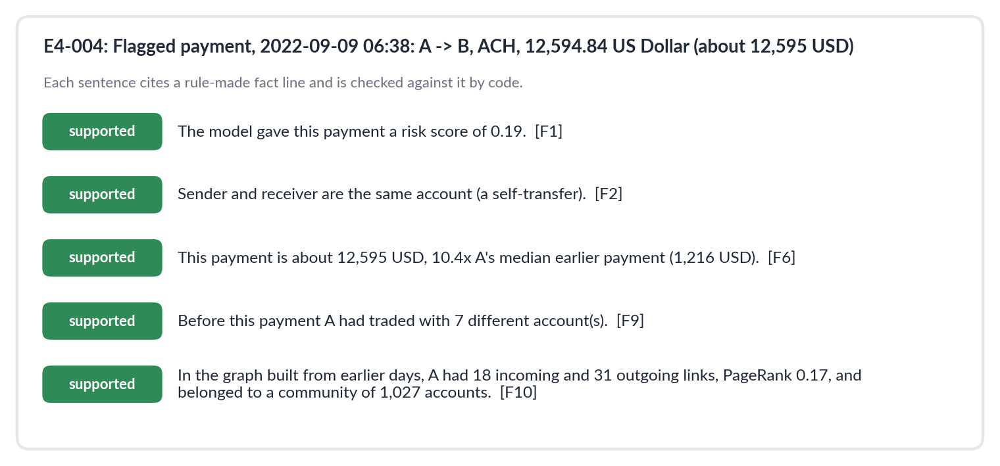</td>
<td align="center"><b>A wrong number is caught</b><br>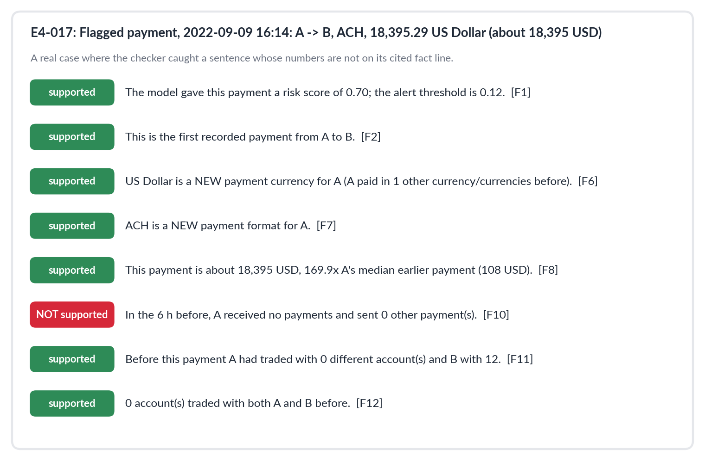</td>
</tr>
</table>

<p align="center">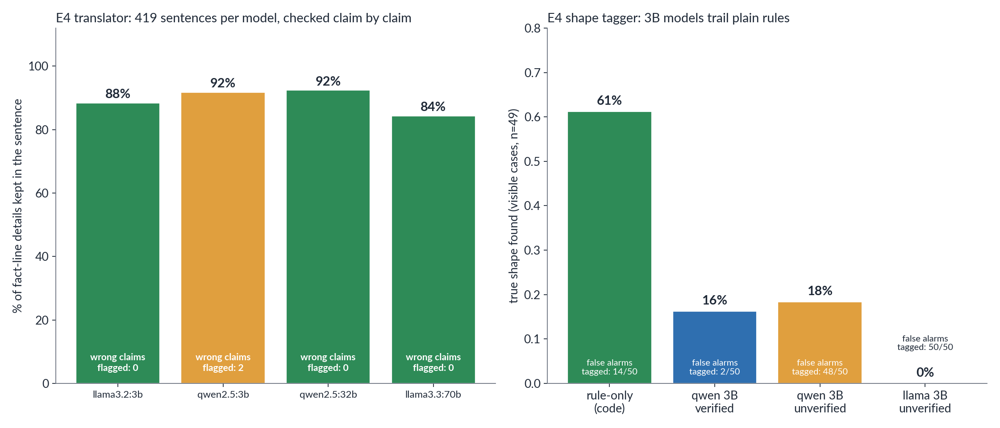</p>

Four open models were checked on 50 flagged cases (419 sentences each, 1,676 in total). Only 2 sentences were wrong, both from one model, and the checker flagged both. Naming laundering shapes was better done by plain rules (61% of visible cases) than by a 3B LLM (16%). The honest summary: **the LLM is a safe translator, but it adds nothing over code when naming shapes.** Details in [`docs/e4_tagger_notes.md`](docs/e4_tagger_notes.md).

## See the real graph

Live Neo4j Browser views of the real IBM laundering graph. Laundering labels are never stored in the graph; the accounts come from IBM's pattern file.

<table>
<tr>
<td align="center"><b>A 10-account laundering cycle</b><br>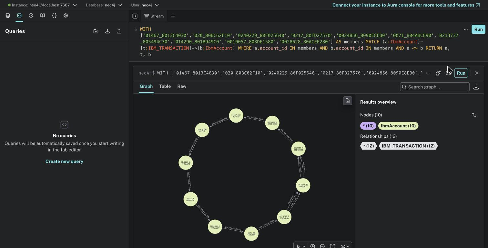</td>
<td align="center"><b>A fan-in with 27 accounts</b><br>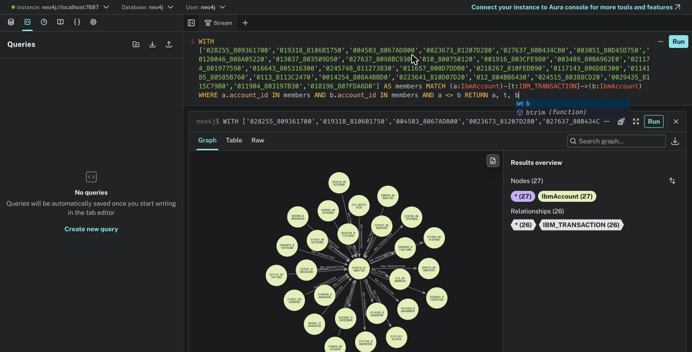</td>
</tr>
</table>

<details>
<summary><b>Past-only neighbourhood of one flagged payment, and a hub account</b></summary>
<p align="center">
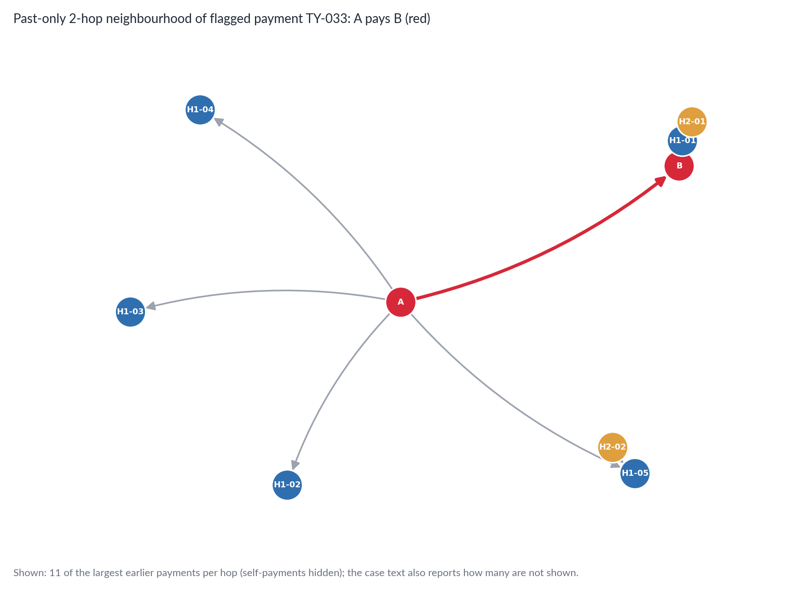
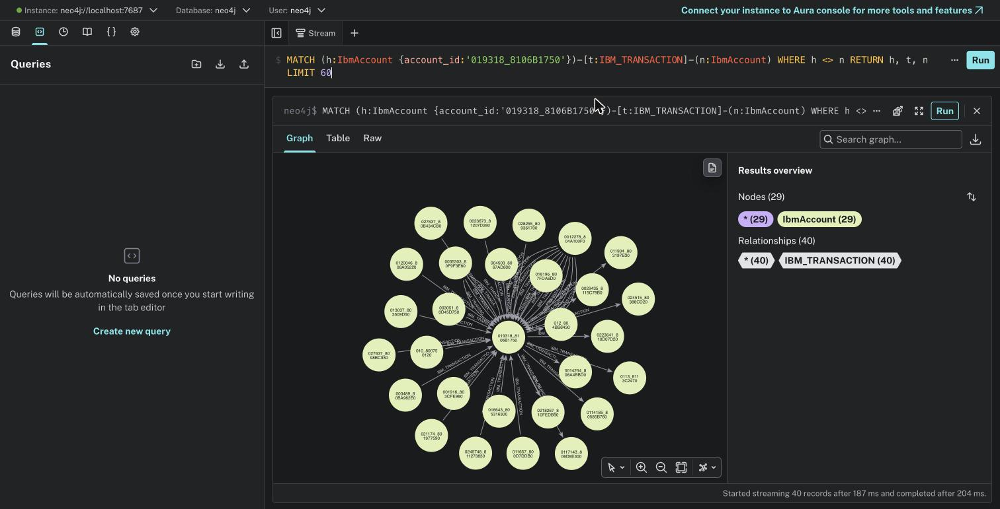
</p>
</details>

## What we found

1. **Graph features and causal patterns lift PR-AUC on the dense IBM graph** (0.229 to 0.594) but **do not help on the sparse PaySim graph**.
2. **Leaky columns inflate scores.** The PaySim balance columns take the score from 0.66 to 0.99.
3. **Tuned XGBoost with explicit graph features beats our GraphSAGE.** GraphSAGE raises fewer false alarms, so its precision is higher, but it catches fewer laundering payments.
4. **A checker makes LLM explanations safe to show.** Only 2 of 1,676 sentences were wrong and both were caught.
5. **These are single-seed results.** Repeat runs with three seeds are planned for the final report.

## Leakage rules

Never relaxed, in every experiment:

- The balance columns and `isFlaggedFraud` are never model inputs in E1-E3 (only in the deliberately naive run).
- A feature or neighbour sample for a payment at time *t* uses only payments at or before *t*, and only labels from the training period.
- Scalers, encoders and thresholds are fitted on the training split only. Test is scored once.

More in [`docs/leakage_notes.md`](docs/leakage_notes.md).

## Repository map

| Course requirement | Folder | What is inside |
|---|---|---|
| **CODE** | [`src/`](src), [`jobs/`](jobs) | All Python code (one script per step) and batch scripts for the ASU Sol cluster |
| **DATA** | [`data/`](data) | How to download the two public datasets, plus small samples ([`data/README.md`](data/README.md)) |
| **EVALUATIONS** | [`results/`](results), [`results_sol/`](results_sol) | Metrics (JSON, CSV), figures (PNG), bootstrap tests, E4 outputs ([`results/README.md`](results/README.md)) |
| Docs | [`docs/`](docs) | EDA notes, leakage rules, E4 design notes |
| Slides | [`presentation/`](presentation) | Final demo presentation (PDF and PowerPoint) and the project presentation |

```text
.
├── src/            one script per step (data prep, E1, E2, E3, E4, figures)
├── jobs/           Slurm batch scripts for the ASU Sol GPU cluster
├── data/           dataset guide and 1,000-row samples
├── results/        metrics, figures, bootstrap tests, E4 outputs
├── results_sol/    best runs trained on Sol
├── docs/           EDA, leakage and E4 notes
├── presentation/   demo deck and project deck
├── assets/         README images
├── docker-compose.yml   Neo4j 5.26 with Graph Data Science
└── requirements-full.txt
```

## Run it yourself

```bash
python3 -m venv .venv && source .venv/bin/activate
pip install -r requirements-full.txt
docker compose up -d        # Neo4j 5.26 + GDS at http://localhost:7474 (local development login in docker-compose.yml)
```

1. Download the two datasets as described in [`data/README.md`](data/README.md) and put the files under `data/raw/`.
2. For E4, install [Ollama](https://ollama.com) and pull the models (for example `llama3.2:3b` and `qwen2.5:3b`).

<details>
<summary><b>Run order, script by script (from the repository root)</b></summary>

| Stage | PaySim | IBM AML |
|---|---|---|
| Prepare and split | `python src/data_prep.py` | `python src/ibm_data_prep.py` |
| E1 features and models | `src/features_tabular.py`, `src/train_tabular.py` | `src/ibm_features_tabular.py`, `src/ibm_train_tabular.py`, `src/ibm_tune_xgboost.py` |
| E2 graph features | `python src/graph_features.py load`, then `src/build_e2_features.py` | `python src/ibm_graph_features.py load` and `features`, then `src/ibm_build_e2_features.py`, `src/ibm_pattern_features.py`, `src/ibm_window_features.py` |
| E2 ablation and final feature set | | `src/ibm_ablation.py`, `src/ibm_ablation_finalize.py` |
| E3 GraphSAGE | `python src/graphsage.py` | `python src/ibm_graphsage.py`, `src/ibm_graphsage_v2.py` |
| Comparison and tests | `src/bootstrap_compare.py`, `src/account_groups.py`, `src/naive_leakage.py`, `src/naive_full_graph.py`, `src/naive_leakage_summary.py` | `src/ibm_account_groups_round2.py`, `src/ibm_final_figures.py` |
| E4 explanations | | `src/e4_select_cases.py`, `src/e4_subgraph_v2.py`, `src/e4_generate_v2.py`, `src/e4_checker.py`, `src/e4_select_cases_typology.py`, `src/e4_tagger.py`, `src/e4_tagger_score.py` |
| Presentation figures | `python src/demo_figures.py all` | |

Each script has a header comment with its exact usage. Some steps (the round-2 ablation, GraphSAGE v2 and the larger E4 models) ran on the ASU Sol GPU cluster using the scripts in `jobs/`; their saved outputs are in `results_sol/`.

</details>

**Reproducibility:** random seeds are fixed in every script, and each experiment writes its metrics to `results/` or `results_sol/`. Trained model files (`.joblib`), feature tables (`.parquet`) and the Neo4j database are not stored here; they are rebuilt by the steps above.

## Team

CSE 573 Semantic Web Mining, Fall 2026, Arizona State University, Group 18, Project 10.

| Member | Area |
|---|---|
| Darshitha Gongle | Data cleaning, subsampling, EDA, temporal splits |
| Maninderjit Singh Bhullar | Tabular baselines (E1), evaluation framework, PR-AUC plots |
| Mithun Menon | Neo4j setup and schema, graph features (E2), feature export |
| Nandan Reddy Jalli | GraphSAGE embeddings and standalone model (E3) |
| Reshikesh Reddy Puttamreddy | Ontology, LLM explanation layer (E4), faithfulness check |
| Everyone | Integration, results comparison, presentation, final report |

**Slides:** [Demo presentation (PDF)](presentation/Group18-Project10-FA26-Group-DEMO-Presentation-FINAL.pdf) · [PowerPoint](presentation/Group18-Project10-FA26-Group-DEMO-Presentation-FINAL.pptx)

## References

1. Federal Trade Commission, "Consumer Sentinel Network Data Book 2024."
2. E. A. Lopez-Rojas, A. Elmir, S. Axelsson, "PaySim: A financial mobile money simulator for fraud detection," EMSS, 2016.
3. E. Altman et al., "Realistic Synthetic Financial Transactions for Anti-Money Laundering Models," NeurIPS Datasets and Benchmarks, 2023.
4. W. L. Hamilton, R. Ying, J. Leskovec, "Inductive representation learning on large graphs," NeurIPS, 2017.
5. J. Blanuša et al., "Graph Feature Preprocessor: Real-time Subgraph-based Feature Extraction for Financial Crime Detection," ICAIF, 2024.
6. B. Egressy et al., "Provably Powerful Graph Neural Networks for Directed Multigraphs," AAAI, 2024.
7. J. Lin et al., "FraudGT: A Simple, Effective, and Efficient Graph Transformer for Financial Fraud Detection," ICAIF, 2024.
